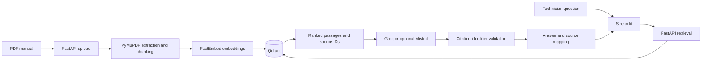

# PV-Assist

**An evidence-grounded documentation assistant for photovoltaic maintenance.**

PV-Assist lets technicians search equipment manuals and ask questions in natural language. It retrieves passages from uploaded PDFs, then produces concise answers tied to stable source identifiers and page-level references. When the indexed manual does not contain enough evidence, the assistant abstains rather than filling gaps with general model knowledge.

> **Demo media**  
> [Screenshot or short demo video to be added]

## Use Case

Photovoltaic maintenance guidance is distributed across long equipment manuals and site procedures. PV-Assist demonstrates a local retrieval-augmented generation (RAG) workflow that helps a user locate relevant manual passages and inspect the evidence behind an answer. The included three-page manual is synthetic development data, not an approved field procedure.

## Features

- PDF upload, page-level text extraction, chunking, and content-hash document identity.
- Local FastEmbed vector generation and Qdrant storage/search.
- Optional document-scoped retrieval for a specific uploaded manual.
- Configurable Groq generation, with optional Mistral support.
- Per-answer source IDs (`S1`, `S2`, …) mapped to the document, content ID, page, and supporting passage.
- Rejection of missing or unknown source IDs; insufficient-evidence abstention.
- Streamlit interface with an explicit submit action and expandable supporting passages.
- Offline automated tests and a small retrieval evaluation set.

## Architecture



For each question, FastAPI uses the existing `DocumentIndex` to retrieve passages. Only passages above the configured retrieval threshold are passed to the selected provider. Each passage gets an ID for that answer; the response carries the ID-to-source mapping. The API validates that cited IDs exist in that mapping before returning the generated answer.

Citation validation is structural: a valid source ID proves only that the identifier maps to a retrieved passage. It does **not** prove that the passage supports the associated claim. Semantic correctness and the appropriateness of generated abstentions still require human review.

## Technology

| Area | Technology |
| --- | --- |
| Language and API | Python 3.12, FastAPI |
| User interface | Streamlit |
| PDF processing | PyMuPDF |
| Embeddings | FastEmbed (`BAAI/bge-small-en-v1.5`) |
| Vector storage and retrieval | Qdrant, Docker Compose |
| Answer generation | Groq (`openai/gpt-oss-20b`); optional Mistral |
| HTTP, configuration, and validation | httpx, Pydantic Settings, pytest, Ruff |

## Setup on Windows

Prerequisites: Python 3.12 and Docker Desktop with Compose. Run commands from the repository root in PowerShell.

Create the environment and install the dependencies listed in `requirements.txt`:

```powershell
py -3.12 -m venv .venv
.\.venv\Scripts\python.exe -m pip install -r requirements.txt
```

Start Qdrant and verify its health:

```powershell
docker compose up -d qdrant
docker compose ps
Invoke-RestMethod http://localhost:6333/healthz
```

Create `.env` only if it does not already exist. Edit it locally to select a provider and configure its key. Never paste keys into source code, terminal logs, or this README.

```powershell
if (!(Test-Path .env)) { Copy-Item .env.example .env }
notepad .env
```

For Groq, configure `LLM_PROVIDER="groq"`, `GROQ_API_KEY`, and optionally `GROQ_MODEL="openai/gpt-oss-20b"`. For Mistral, use `LLM_PROVIDER="mistral"`, `MISTRAL_API_KEY`, and optionally `MISTRAL_MODEL="mistral-small-latest"`. The `.env` file is ignored by Git; `.env.example` contains placeholders only.

Start the API in one PowerShell terminal:

```powershell
$env:PYTHONPATH = "src"
.\.venv\Scripts\python.exe -m uvicorn pv_assist.api:app --reload --port 8001
```

Start Streamlit in a second terminal:

```powershell
$env:PYTHONPATH = "src"
$env:PV_ASSIST_API_URL = "http://localhost:8001"
.\.venv\Scripts\streamlit.exe run src\pv_assist\ui.py
```

The API is available at `http://localhost:8001`; the Streamlit interface is normally at `http://localhost:8501`. `GET /health` reports the selected provider. The API documentation is available at `http://localhost:8001/docs`.

## Upload and Ask

In Streamlit, select a PDF and choose **Index PDF**. The Ask control remains disabled until that PDF has been indexed. Enter a question and submit it; the response displays human-readable document/page citations and an expandable list of supporting passages.

The upload endpoint returns a SHA-256 `document_id`. To use the API directly, upload the included smoke manual:

```powershell
$upload = curl.exe -s -F "file=@tests/fixtures/pv_maintenance_smoke.pdf" http://localhost:8001/documents/upload | ConvertFrom-Json
$upload
```

Pass the returned ID to `/ask` to restrict retrieval to that manual:

```powershell
$body = @{ question = "How should photovoltaic modules be cleaned?"; document_id = $upload.document_id } | ConvertTo-Json
Invoke-RestMethod -Uri http://localhost:8001/ask -Method Post -ContentType "application/json" -Body $body
```

The live request uses the configured provider and may consume API quota. Automated tests and retrieval evaluation do not make provider calls.

## Tests and Evaluation

Run the test suite and lint checks using the project environment:

```powershell
.\.venv\Scripts\python.exe -m pytest -v
.\.venv\Scripts\python.exe -m ruff check .
```

The tests use mocked provider responses for answer-generation behavior. The real Qdrant integration test requires the Compose service to be running.

Index `tests/fixtures/pv_maintenance_smoke.pdf` through the upload endpoint before running the retrieval evaluation. It derives the manual's content ID and performs local FastEmbed/Qdrant search only:

```powershell
.\.venv\Scripts\python.exe scripts\evaluate_rag.py --top-k 2
```

The evaluation set contains **15 questions**: **11 answerable** and **4 expected-abstention** questions. In the verified run, **11/11** answerable questions retrieved at least one annotated source page in the top two results (Page Hit Rate @2: **100%**). This is a retrieval metric only; it is not answer accuracy.

The script reported **0 citation checks** because no recorded model answers were supplied, and made **0 LLM calls**. It can optionally check the structural validity of recorded `[S1]`-style identifiers using `--answers-json`; identifier membership still does not evaluate factual support. Citation correctness, semantic factual correctness, and whether a generated abstention was appropriate have not been measured.

The four questions expected to require abstention are:

- `Q05`: Detailed lockout/tagout sequence and voltage-test limits.
- `Q10`: Manufacturer detergent brand and dilution ratio.
- `Q14`: Maximum temperature difference between neighboring modules.
- `Q15`: PPE class, arc-flash boundary, and regulatory standard.

The deterministic mocked pytest cases separately exercise missing/unknown citations, explicit abstention, and high-similarity retrieval that still warrants abstention. These checks do not replace human review of semantic support.

## Limitations

- The evaluation set is small and based on one synthetic three-page manual; it is not representative of manufacturer documentation or field conditions.
- No semantic answer-accuracy or claim-to-passage entailment measurement has been completed.
- Expected retrieval-page hits do not establish that a generated answer is correct or safe.
- No public cloud deployment, authentication, authorization, rate limiting, or production security hardening is included.
- Answer generation requires a valid key for the selected provider; automated tests do not validate live provider availability or output quality.
